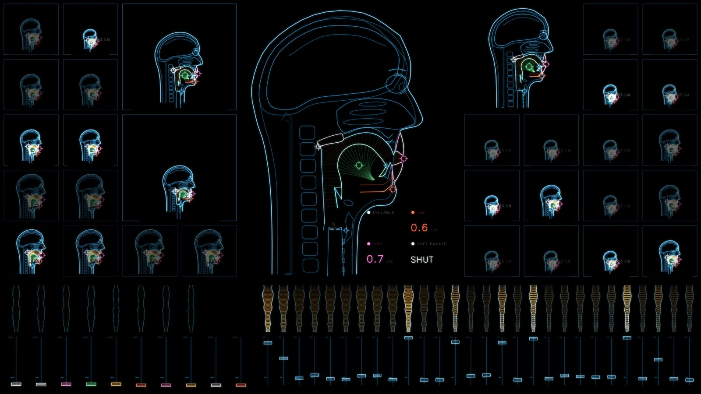

# I'm Not in Love, sung by one simulated throat

10cc's "I'm Not in Love" (1975), rebuilt with [Chimera](https://github.com/jamesondh/chimera-vocal-synth), the vocal synth by Jameson Hodge. Every sound in the track comes from Chimera. Every face in the video is Chimera's own screen, replaying what the synth sang.

[](https://github.com/b1rdmania/chimera-10cc/releases/download/v1/im-not-in-love-chimera-cut.mp4)

**Watch:** [the 38-second cut](https://github.com/b1rdmania/chimera-10cc/releases/download/v1/im-not-in-love-chimera-cut.mp4) · [the full track, 3:45](https://github.com/b1rdmania/chimera-10cc/releases/download/v1/im-not-in-love-chimera-full.mp4)

**Chimera:** [repo](https://github.com/jamesondh/chimera-vocal-synth) · [try it in the browser](https://chimera.audio)

## Why this song

Most synths make sounds. Chimera grows a voice: it simulates the lungs, vocal folds, airway and lips, with no samples and no neural audio. That makes it a new instrument.

In 1975, 10cc built a new instrument too. They wanted a choir without a choir or a synth. So they sang every note 16 times, three voices at a time, cut the recordings into long tape loops, and played the loops on the mixing desk faders like keys. That is 624 voices from three people.

This repo does the same trick with one simulated throat.

## How the track is made

- **Lead.** One male Chimera voice sings the melody. A quiet, slightly out-of-tune copy plays 12 ms behind it, like 1970s double-tracking.
- **The choir.** One held "ah" of about 10 seconds for each note, looped like tape. Each note has 2 to 5 copies across male, female and child voices, each a little out of tune. Every loop plays all the time at a low level, because 10cc taped their faders so they never fully closed. A loop comes up when its chord plays.
- **The high line.** Female and child voices hold the top note of each chord, about an octave above the rest.
- **Harmonies.** Voices a third above and below the lead in the choruses, the bridge and the end.
- **The break.** An "ooh" melody, copied from the original.
- **The fill.** A hummed, electric-piano-style figure at the end of each verse half. It swings left and right five times a second.
- **The whisper.** "Big boys don't cry" uses Chimera's whisper mode, where the vocal folds don't vibrate.
- **The kick.** Chimera's beatbox mouth.
- **Stereo.** Each loop sits in its own place from left to right, as wide as the original.

## How the video is made

Chimera draws its voice as it sings: the head in cross-section, the airway, the vocal folds, the sound spectrum. When it renders a note, it can also save that data frame by frame. The video plays that data back through Chimera's own screens, one face per voice that is actually sounding. Verses show one face. The bridge shows 32. A virtual clock steps the browser one frame at a time, so the picture stays in exact sync with the sound.

## What is not here

The original recording, the lyrics and the note transcription are copyright, so they are not in this repo. You bring your own. [inputs/README.md](inputs/README.md) shows the formats.

## Make it yourself

You need: macOS or Linux, Rust, Bun, Python 3 with numpy, ffmpeg and Node.

1. **Build Chimera with this repo's patch.** The patch adds a whisper switch and the playback screens.

   ```sh
   git clone https://github.com/jamesondh/chimera-vocal-synth
   git clone https://github.com/b1rdmania/chimera-10cc
   cd chimera-vocal-synth
   git checkout $(cat ../chimera-10cc/patches/BASE_COMMIT)
   git apply ../chimera-10cc/patches/chimera-local.patch
   cargo build --release -p chimera-cli
   bun install
   cd ../chimera-10cc
   ```

2. **Add your inputs.** See [inputs/README.md](inputs/README.md).

3. **Make the track.** This takes 10 to 20 minutes and writes `not-in-love-full.wav`.

   ```sh
   CHIMERA=../chimera-vocal-synth/target/release/chimera ./render.sh
   ```

4. **Make the video.** Each capture step takes about 4 minutes.

   ```sh
   npm install && npx playwright install chromium
   python3 film/env.py
   CHIMERA_REPO=../chimera-vocal-synth python3 film2/tools/prep3.py --render
   (cd ../chimera-vocal-synth && bun run dev) &
   mkdir -p film2/segs
   node film2/tools/cap3.mjs video 0 75 film2/segs/a.mp4
   node film2/tools/cap3.mjs video 75 150 film2/segs/b.mp4
   node film2/tools/cap3.mjs video 150 225 film2/segs/c.mp4
   ./film2/tools/assemble.sh
   ```

## Known gaps

- The melody comes from a crowd-sourced transcription, so some notes may be off.
- The fill was worked out from separated audio, not checked by ear.
- Some consonants are soft.
- The patch is a quick local change for this video, not a Chimera feature.
- The full render and capture have run on one machine. Expect some first-run friction.

## Credits

- [Chimera](https://github.com/jamesondh/chimera-vocal-synth) by Jameson Hodge, MIT.
- "I'm Not in Love" by Eric Stewart and Graham Gouldman, recorded by 10cc, 1975.
- Built by [@b1rdmania](https://github.com/b1rdmania) with Claude Code.

## License

The scripts are MIT. The song and the recording belong to their owners.
